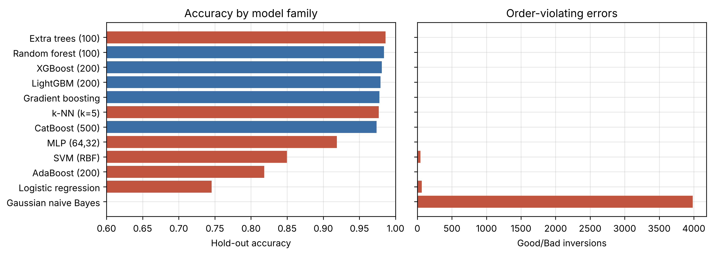
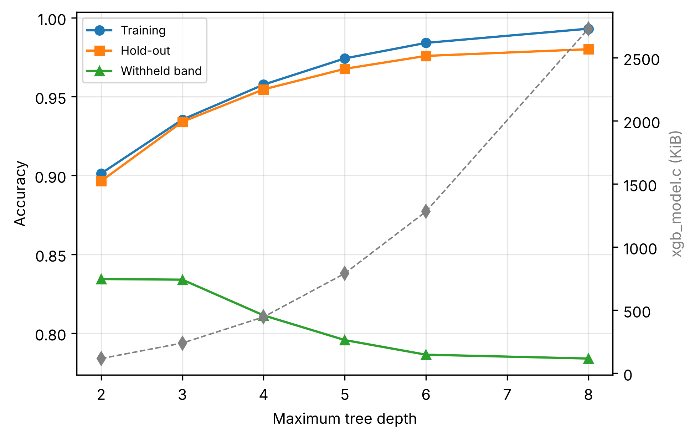
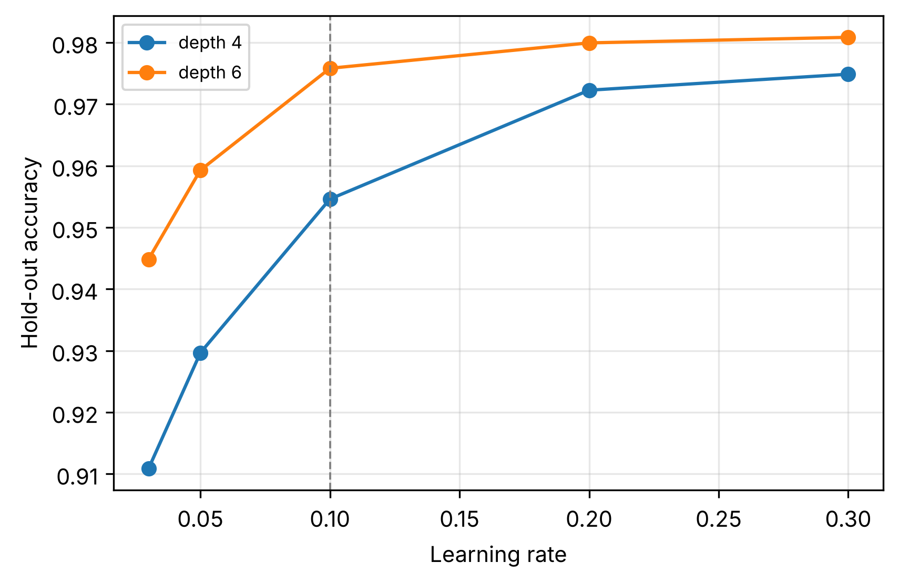
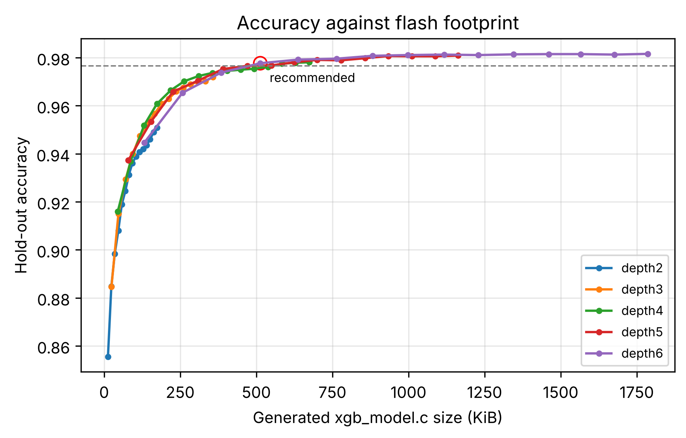
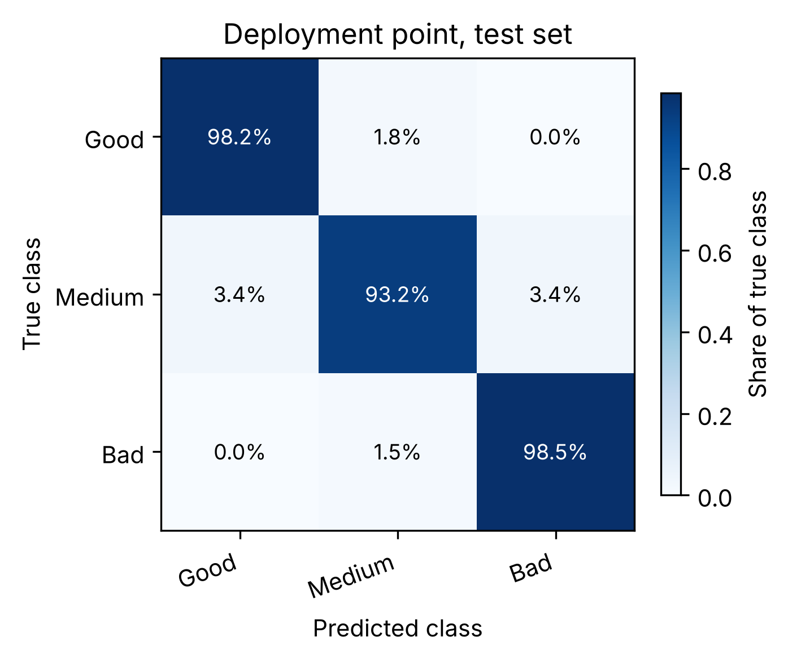

# Adaptive TLS: Runtime Classifier Training

Training, evaluation and C99 export pipeline for the XGBoost performance classifier that drives adaptive cipher-suite switching inside the [CAL/wolfSSL TLS 1.3 stack](https://github.com/Hussein-Net91/CAL) on the ESP32-P4.

The classifier does not predict a cipher name. Given the metrics of the cipher currently in use, at the node's present clock frequency and payload size, it predicts a performance class (**Good**, **Medium** or **Bad**), and the firmware uses that class to decide whether to trigger a mid-session `cipher_update` without tearing the session down.

**At a glance.** The deployed model is a depth-4 ensemble at a learning rate of 0.30, truncated to 100 boosting rounds. It is the most accurate configuration whose generated C fits a 256 KiB flash budget: 218.8 KiB of source, about 96 KiB compiled. On the 17,712-record test set it scores 96.64 % (macro F1 0.966, Cohen's κ 0.950) and never confuses Good with Bad. The most accurate configuration in the search reaches 98.17 % but generates 2,956 KiB of C.

## Contents

- [Repository layout](#repository-layout)
- [Data](#data)
- [Running](#running)
- [Pipeline](#pipeline)
- [Results](#results)
- [Deploying on the ESP32-P4](#deploying-on-the-esp32-p4)
- [Notes and limitations](#notes-and-limitations)

## Repository layout

```
├── xgb_ch5_model_selection_and_tuning.ipynb   full pipeline, executed, with all outputs
├── results/                                   output of the reference run
│   ├── chapter5_results.md                    every table in Markdown, with figure links
│   ├── results.json                           machine-readable summary
│   ├── tables/                                38 CSV tables (Tables 5.1 to 5.38)
│   ├── figures/                               16 figures, PNG and SVG at 300 dpi
│   └── models/
│       ├── deployment_depth4_r100/            the deployed model: xgb_model.c, xgb_model.h
│       ├── recommended_depth6_r080/           smallest model within 0.5 points of the best on the front
│       ├── maxacc_depth6_r300/                most accurate point on the front
│       └── baseline_depth6_r200/              library defaults
├── tools/
│   ├── verify_c_export.py                     checks the exported C against Python on the test set
│   └── harness.c
├── requirements.txt                           package versions of the reference run
└── LICENSE                                    GNU GPL v2.0
```

## Data

The notebook consumes the raw benchmark captures of the **LiTRA** dataset (Lightweight TLS Record AEAD), published on Zenodo: [10.5281/zenodo.22172691](https://doi.org/10.5281/zenodo.22172691). The deposit holds one archive per CPU clock (360, 180, 90, 40 and 20 MHz).

The raw files are not stored in this repository. Place one client-side capture per clock next to the notebook under the following names, or edit the `DATASETS` dictionary in cell 2:

```
client-20.csv   client-40.csv   client-90.csv   client-180.csv   client-360.csv
```

Each file holds the `RESULT` lines emitted by the benchmark firmware, 29 comma-separated fields per record. A header row, if present, is detected and dropped.

## Running

**Google Colab.** Open the notebook in Colab and run all cells. Cell 2 asks for the CSV files if they are not already present, and the final cell downloads `chapter5_bundle.zip`.

**Locally.**

```bash
python -m venv .venv
source .venv/bin/activate          # Windows: .venv\Scripts\activate
pip install -r requirements.txt
jupyter notebook xgb_ch5_model_selection_and_tuning.ipynb
```

A run writes its output to `chapter5_out/`, which has the same structure as `results/`, and packs it into `chapter5_bundle.zip`. The reference run took about 16 minutes on two CPU cores with Python 3.13 and the versions pinned in `requirements.txt`. Set `QUICK_MODE = True` in cell 3 for a smoke test; figures from such a run must not be quoted.

## Pipeline

1. **Ingestion and harmonisation.** Clock strings are reduced to integers, board identifiers and cipher-suite spellings are canonicalised, and invalid rows are removed and counted, including records logged before a clock switch settled.
2. **Features.** 18 features. Energy is an analytical proxy, `E = P_ACTIVE_MW × cycles_mean / f_cpu`. Outliers are clipped by IQR inside each (band, payload) cell and gaps are filled with the band median.
3. **Labels.** A weighted, min–max-normalised composite of the priority features is cut into terciles inside each (clock band, payload size) cell, so a label reflects how a cipher stands under a given clock and payload rather than the clock itself.
4. **Split.** Stratified 80/20 hold-out split (seed 50). All tuning uses the training partition only.
5. **Model families.** Twelve learners at their library defaults on the same split, with the number of Good↔Bad inversions recorded for each (Section 10a).
6. **Search.** Eighteen configurations under stratified 5-fold cross-validation, ninety fits in total: depth 4, 6 or 8; learning rate 0.10, 0.20 or 0.30; minimum child weight 1 or 5; `reg_lambda` fixed at 2.0. One-parameter sweeps of depth and learning rate explain what each control buys (Section 11a).
7. **Grid winner.** The cross-validated winner is refitted and evaluated, followed by importance, learning curve, error analysis, leave-one-band-out transfer, feature-set ablation and priority-weight sensitivity (Sections 12 to 17c).
8. **Truncation front.** One ensemble per depth from 2 to 6, all at a learning rate of 0.30 and minimum child weight 1, is trained to 300 rounds and truncated every 20 rounds. Because boosting is additive, every prefix is itself a valid model, so one fit gives the whole accuracy against size curve (Section 19).
9. **Flash-budget selection.** The deployment point is the most accurate point on the front whose generated C fits `FLASH_BUDGET_KB = 256` (Section 19a). It is then evaluated and exported on its own (Section 19c).
10. **Export.** `xgb_model.c` and `xgb_model.h` for the deployment point, the accuracy-tolerance point, the most accurate point on the front and the library defaults (Section 20).

## Results

All figures below come from the reference run stored in [`results/`](results/). The complete set of tables is in [`results/chapter5_results.md`](results/chapter5_results.md).

### Corpus

| Band | Records read | Dropped | Kept |
|---|---:|---:|---:|
| 20 MHz | 16,830 | 0 | 16,830 |
| 40 MHz | 17,127 | 80 | 17,047 |
| 90 MHz | 21,440 | 0 | 21,440 |
| 180 MHz | 16,354 | 0 | 16,354 |
| 360 MHz | 16,887 | 0 | 16,887 |
| **Total** | **88,638** | **80** | **88,558** |

The 80 dropped rows were logged at the 40 MHz capture before the clock switch settled. Every band covers all eight cipher suites (AES-128-GCM, ChaCha20-Poly1305, ASCON-128, TinyJAMBU, GIFT-COFB, Grain-128AEADv2, Schwaemm and a Null-AEAD SHA-256 reference) and all twelve payload sizes from 16 B to 16 KiB. Tercile labelling yields balanced classes (29,537 Good, 29,491 Medium, 29,530 Bad), split into 70,846 training and 17,712 test records.

### Model families

All learners at their library defaults on the same split (Table 5.8). An inversion is a Good record predicted Bad or the reverse, the two errors that would damage a live session.

| Model | Accuracy | Cohen's κ | Inversions | Exported form |
|---|---:|---:|---:|---|
| Extra trees (100) | 0.9860 | 0.9790 | 1 | arrays, no truncation |
| Random forest (100) | 0.9840 | 0.9760 | 0 | arrays, no truncation |
| XGBoost (200 rounds) | 0.9809 | 0.9713 | 0 | arrays, truncatable |
| LightGBM (200) | 0.9792 | 0.9687 | 0 | arrays, truncatable |
| Gradient boosting (histogram) | 0.9775 | 0.9663 | 0 | no exporter in this work |
| k-NN (k = 5) | 0.9767 | 0.9650 | 7 | stores the training set |
| CatBoost (500) | 0.9739 | 0.9608 | 0 | arrays, truncatable |
| MLP (64, 32) | 0.9189 | 0.8783 | 2 | weights, float matmul |
| SVM (RBF) | 0.8498 | 0.7747 | 44 | stores support vectors |
| AdaBoost (200) | 0.8183 | 0.7275 | 6 | arrays, truncatable |
| Logistic regression | 0.7455 | 0.6183 | 64 | closed form |
| Gaussian naive Bayes | 0.4280 | 0.1418 | 3,984 | closed form |

The forests lead on accuracy but flatten into fixed arrays with no equivalent of truncation, so they cannot be moved along a flash budget. Boosted ensembles can, which is why the rest of the pipeline develops XGBoost.



### What depth and learning rate buy

At a learning rate of 0.10 and 200 rounds (Table 5.11), in-distribution accuracy rises with depth while accuracy on a clock band withheld from training falls, and the generated C grows by a factor of 23:

| Max depth | Training | Test | Withheld band (mean) | Nodes | C source (KiB) |
|---:|---:|---:|---:|---:|---:|
| 2 | 0.9013 | 0.8965 | 0.8343 | 4,188 | 117 |
| 3 | 0.9355 | 0.9341 | 0.8340 | 8,706 | 240 |
| 4 | 0.9576 | 0.9546 | 0.8113 | 16,040 | 446 |
| 5 | 0.9742 | 0.9676 | 0.7957 | 28,200 | 791 |
| 6 | 0.9841 | 0.9758 | 0.7864 | 45,468 | 1,282 |
| 8 | 0.9931 | 0.9801 | 0.7839 | 96,154 | 2,731 |

The learning rate costs nothing in flash. At depth 4 and 200 rounds, raising it from 0.10 to 0.30 moves test accuracy from 0.9546 to 0.9749; at depth 6 the same change moves it from 0.9758 to 0.9809 (Table 5.12).

<p>


</p>

### Cross-validated search

| Depth | Learning rate | Min child weight | CV accuracy | CV std |
|---:|---:|---:|---:|---:|
| **8** | **0.20** | **1** | **0.9808** | 0.0008 |
| 8 | 0.20 | 5 | 0.9807 | 0.0008 |
| 8 | 0.30 | 1 | 0.9806 | 0.0009 |
| 8 | 0.30 | 5 | 0.9803 | 0.0009 |
| 6 | 0.30 | 1 | 0.9803 | 0.0009 |
| 6 | 0.20 | 1 | 0.9800 | 0.0010 |
| 6 | 0.30 | 5 | 0.9799 | 0.0008 |
| 8 | 0.10 | 1 | 0.9798 | 0.0007 |
| 6 | 0.20 | 5 | 0.9796 | 0.0006 |
| 8 | 0.10 | 5 | 0.9790 | 0.0006 |
| 4 | 0.30 | 5 | 0.9773 | 0.0009 |
| 4 | 0.30 | 1 | 0.9772 | 0.0007 |
| 6 | 0.10 | 1 | 0.9762 | 0.0007 |
| 6 | 0.10 | 5 | 0.9758 | 0.0010 |
| 4 | 0.20 | 1 | 0.9738 | 0.0008 |
| 4 | 0.20 | 5 | 0.9732 | 0.0006 |
| 4 | 0.10 | 1 | 0.9591 | 0.0007 |
| 4 | 0.10 | 5 | 0.9584 | 0.0010 |

The winner, depth 8 at a rate of 0.20, scores 0.9817 on the test set but generates 2,956 KiB of C at its 250 rounds, far beyond what the node can hold beside the TLS stack. At any depth and rate, the minimum child weight moves cross-validated accuracy by less than a tenth of a percentage point.

### Selection under a flash budget

Every depth on the front shares a learning rate of 0.30 and minimum child weight 1, so the front compares depth and round count and nothing else (Table 5.28). The best point under each budget (Table 5.29):

| Flash budget | Configuration | Rounds | C source (KiB) | Test accuracy |
|---|---|---:|---:|---:|
| 128 KiB | depth 3 | 100 | 117.8 | 0.9475 |
| **256 KiB** | **depth 4** | **100** | **218.8** | **0.9664** |
| 512 KiB | depth 5 | 120 | 471.4 | 0.9766 |
| 1,024 KiB | depth 6 | 160 | 998.1 | 0.9811 |
| front maximum | depth 6 | 300 | 1,786.2 | 0.9816 |

The front is steep at the small end and nearly flat beyond half a megabyte. At depth 4, 100 rounds give 0.9664 for 218.8 KiB and 120 rounds give 0.9702 for 263.2 KiB, just over the budget.



The circle in this figure marks the accuracy-tolerance point (depth 6, 80 rounds, 513 KiB), the smallest model within 0.5 points of the best on the front. The deployed model is the 256 KiB point.

### The deployment point

Depth 4, learning rate 0.30, minimum child weight 1, `reg_lambda` 2.0, truncated at 100 rounds: 300 trees and 8,034 nodes (Tables 5.31 to 5.38).

| Stage | Accuracy | Balanced acc. | Macro F1 | Cohen's κ | MCC |
|---|---:|---:|---:|---:|---:|
| Cross-validation (out-of-fold) | 0.9659 | 0.9658 | 0.9658 | 0.9488 | 0.9488 |
| Test set | 0.9664 | 0.9663 | 0.9662 | 0.9495 | 0.9497 |

| | Pred. Good | Pred. Medium | Pred. Bad |
|---|---:|---:|---:|
| **True Good** | 5,803 | 105 | 0 |
| **True Medium** | 203 | 5,496 | 199 |
| **True Bad** | 0 | 89 | 5,817 |

| Class | Precision | Recall | F1 | ROC AUC |
|---|---:|---:|---:|---:|
| Good | 0.9662 | 0.9822 | 0.9741 | 0.9987 |
| Medium | 0.9659 | 0.9318 | 0.9486 | 0.9949 |
| Bad | 0.9669 | 0.9849 | 0.9758 | 0.9988 |

Every error falls between adjacent tiers, and the test set holds no Good↔Bad inversion.



**Errors as protocol actions.** Rates are relative to the records of the true tier; the last column gives the grid winner for comparison (Table 5.34).

| Policy outcome | True tier | Records | Deployment | Grid winner |
|---|---|---:|---:|---:|
| Correct action | any | 17,116 | 96.64 % | 98.17 % |
| Missed switch (Bad read as Good) | Bad | 0 | 0.00 % | 0.00 % |
| Spurious switch (Good read as Bad) | Good | 0 | 0.00 % | 0.00 % |
| Under-reaction (Bad read as Medium) | Bad | 89 | 1.51 % | 1.42 % |
| Over-reaction (Medium read as Bad) | Medium | 199 | 3.37 % | 1.49 % |
| Needless adjustment (Good read as Medium) | Good | 105 | 1.78 % | 1.10 % |
| Missed adjustment (Medium read as Good) | Medium | 203 | 3.44 % | 1.48 % |

The flash budget costs 1.5 points of accuracy, all of it in one-step errors, for a model 13.5 times smaller in source.

**Where the errors fall.**

| Cipher | Accuracy | | Band | Accuracy |
|---|---:|---|---|---:|
| AES-128-GCM | 1.0000 | | 20 MHz | 0.9652 |
| GIFT-COFB | 0.9925 | | 40 MHz | 0.9497 |
| Grain-128AEADv2 | 0.9802 | | 90 MHz | 0.9753 |
| ChaCha20-Poly1305 | 0.9770 | | 180 MHz | 0.9771 |
| Null-AEAD (SHA256) | 0.9722 | | 360 MHz | 0.9629 |
| Schwaemm | 0.9562 | | | |
| ASCON-128 | 0.9491 | | | |
| TinyJAMBU | 0.9130 | | | |

Ciphers that sit in one tier at almost every operating point are recovered almost without error; those that move between tiers with payload and clock carry most of the errors. Across payload sizes accuracy ranges from 0.9492 at 32 B to 0.9874 at 8 KiB (Table 5.37).

**Transfer to an unseen clock.** Retrained with one band withheld, the deployment configuration scores 0.7482 (20 MHz), 0.8739 (40 MHz), 0.8097 (90 MHz), 0.8108 (180 MHz) and 0.7885 (360 MHz) on that band, a mean of 0.8062 (Table 5.38). The grid winner transfers worse, with a mean of 0.7766 (Table 5.23).

### The grid winner (Sections 12 to 17c)

These sections evaluate the cross-validated winner (depth 8, learning rate 0.20, 250 rounds), which serves as the accuracy-optimal reference.

| Stage | Accuracy | Macro F1 | Cohen's κ | MCC |
|---|---:|---:|---:|---:|
| Cross-validation (out-of-fold) | 0.9808 | 0.9808 | 0.9712 | 0.9712 |
| Test set | 0.9817 | 0.9817 | 0.9726 | 0.9726 |

ROC AUC is 0.9996, 0.9985 and 0.9996 for Good, Medium and Bad (Table 5.17), and the test set again holds no inversion (Table 5.13).

- **Importance (Table 5.18).** Permutation importance is dominated by `cycles_per_bit` (accuracy drop 0.460) and `cycles_mean` (0.341), followed by `latency` (0.059), `stack_per_msg` (0.054) and `Flash_used` (0.043). `Flash_used`, constant for each cipher build, ranks first by split gain (27.7 %), so the gain ranking partly reflects cipher identity rather than run-time behaviour.
- **Learning curve (Table 5.19).** With 3-fold cross-validation at 125 rounds, validation accuracy rises from 0.9441 at 4,723 training records to 0.9799 at 47,230.
- **Feature-set ablation (Table 5.24).**

  | Feature set | Features | Test accuracy | Withheld band (mean) |
  |---|---:|---:|---:|
  | A, all features | 18 | 0.9817 | 0.7631 |
  | B, without build constants | 14 | 0.9802 | 0.7663 |
  | C, timing only | 12 | 0.9677 | 0.7828 |
  | D, clock-invariant work metrics | 7 | 0.9534 | 0.8268 |

  Dropping the four static build constants costs 0.15 points, so the model reads behaviour rather than cipher identity. The seven clock-invariant work metrics transfer best to an unseen band.
- **Priority weights (Table 5.25).** Relabelling under latency-led, footprint-led and uniform weights gives 0.9840, 0.9800 and 0.9805 against 0.9817 for the baseline, although the footprint-led labels agree with the baseline on only 41.5 % of records. Weighted and unweighted scaling give identical accuracy under every profile: the weights act through the labels alone, and accuracy by itself does not validate a weighting.
- **Reference classifiers (Table 5.27).** Majority class 0.3336, a single depth-4 tree 0.7444, random forest 0.9840, XGBoost defaults 0.9809, grid winner 0.9817.

## Deploying on the ESP32-P4

Copy `results/models/deployment_depth4_r100/` (or the `deployment_*` folder of your own run) into the firmware tree. The generated code is self-contained C99 with static tables, compiles without warnings under `-std=c99 -Wall`, and occupies about 96 KiB of text when compiled with `gcc -O2`. Its node table, which dominates the size, has the same layout on the 32-bit RISC-V core.

```c
#include "xgb_model.h"

float raw[XGB_N_FEATURES] = { /* in the order listed in xgb_model.h */ };
int cls = xgb_predict_raw(raw);            /* min–max scaling, clipping and weighting inside */
const char *label = xgb_class_label(cls);  /* "Good", "Medium" or "Bad" */
```

The order of the on-device `features[]` array must match the training order exactly. The exporter writes it as a comment in `xgb_model.h`:

```
lat_per_byte, E_lat_per_byte, cycles_per_bit, throughput, Energy, stack_per_msg,
latency, E_latency, cycles_mean, payload_size, heap_per_msg, Flash_used, Ex_code,
rodata, total_memory, cv_latency, lat_per_byte_std, E_lat_per_byte_std
```

`tools/verify_c_export.py` compiles the exported model with a small harness and compares it with the Python booster on the test set. For the reference run the two agree on all 17,712 records (accuracy 0.9664 in both).

## Notes and limitations

- Energy is an analytical proxy with `P_ACTIVE_MW = 90.0`. Replace it with a measured active-power figure before quoting absolute energy.
- The priority vector `FEATURE_PRIORITY` defines the labels. Its multiplicative role in the scaler has no effect on tree splits.
- A clock setting absent from training costs roughly 16 points at the deployment point (0.8062 against 0.9664). Every clock intended for deployment should appear in the training data.
- Sections 14, 15, 17b and 17c (importance, learning curve, ablation, priority weights) are computed for the grid winner, not for the deployment point.
- Results depend slightly on library versions. Under other XGBoost releases, test accuracy at the deployment point has varied by a few records in 17,712, and node counts by a few per cent.

## Related

- CAL, the Cryptographic Abstraction Layer integrating NIST LWC AEAD algorithms into wolfSSL TLS 1.3: <https://github.com/Hussein-Net91/CAL>
- LiTRA dataset: <https://doi.org/10.5281/zenodo.22172691>

## Author

Hussein A. Al-Shmailawi, Department of Information and Communications Engineering, Al-Nahrain University, Baghdad, in collaboration with ivESK, Offenburg University of Applied Sciences.

## Licence

The code is released under the GNU General Public License v2.0; see `LICENSE`. The LiTRA dataset is distributed separately under CC BY 4.0.
