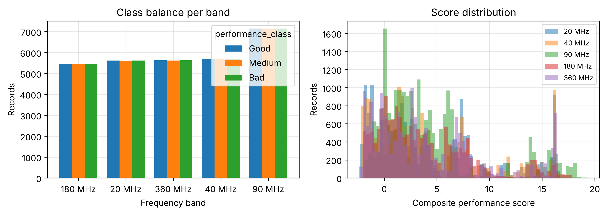
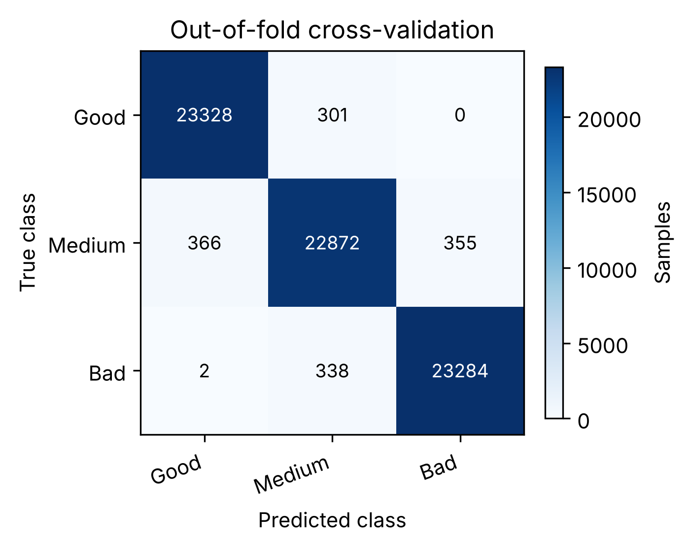
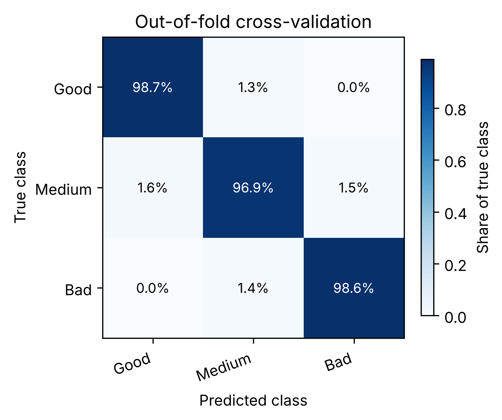
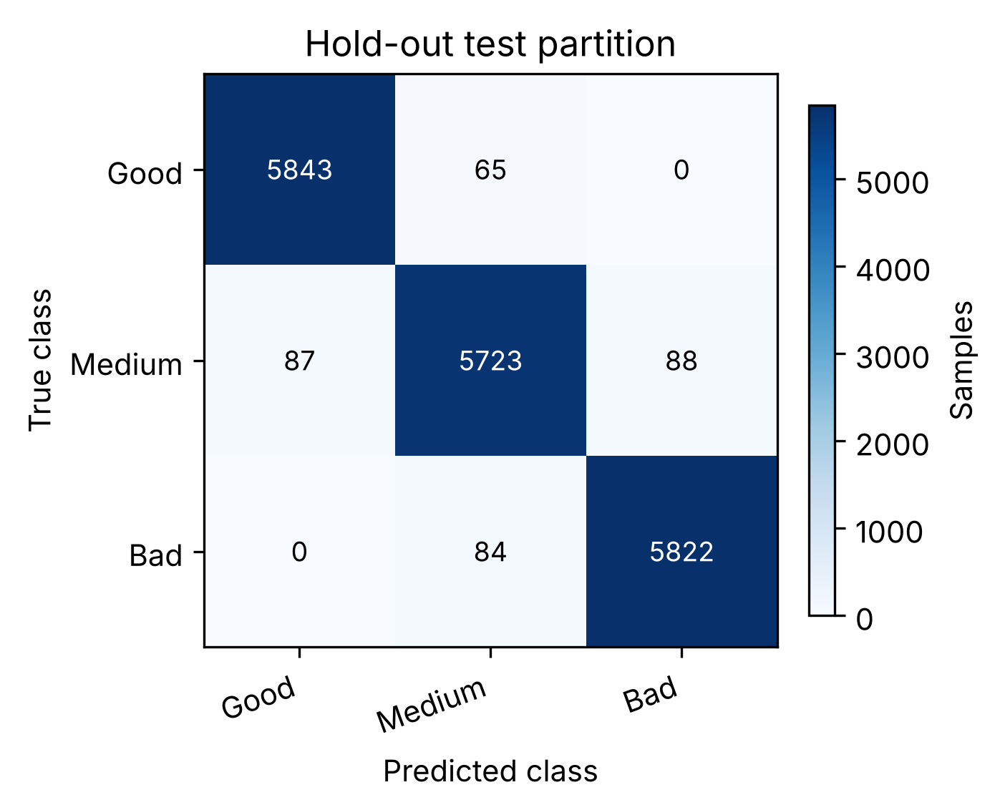
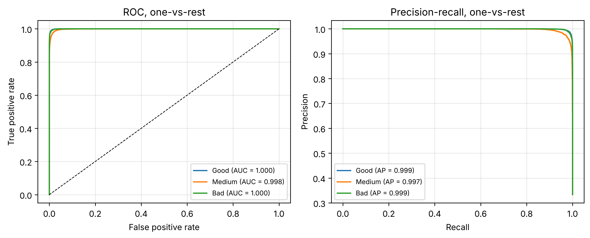
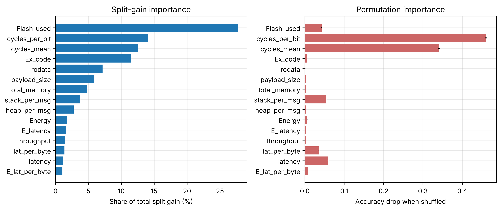
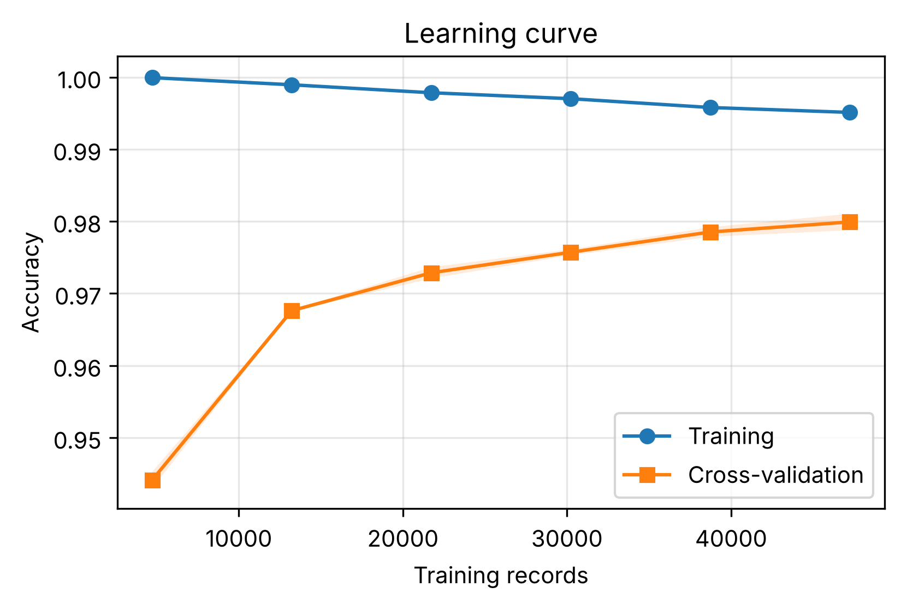
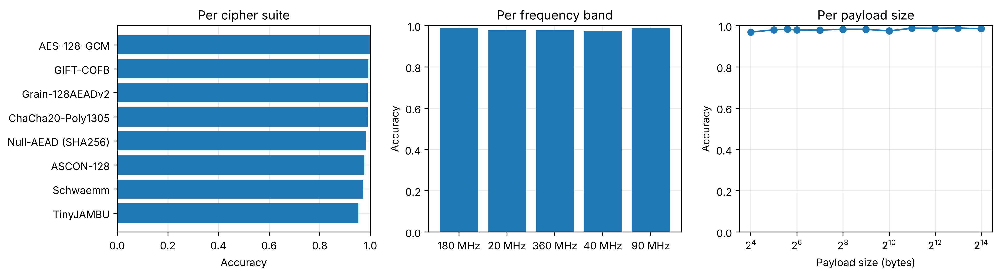
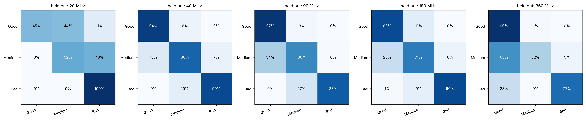
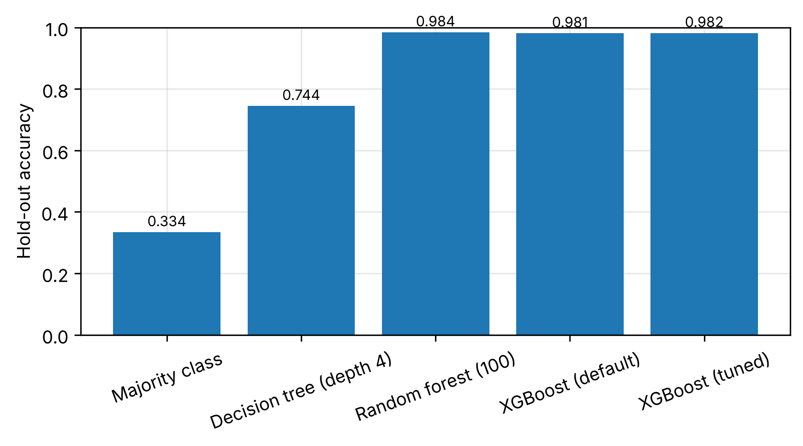

# Chapter 5 machine-learning results

Corpus: 88,558 records, 18 features, 8 cipher suites, 5 frequency bands. Labels: per_freq_payload terciles of the weighted composite score. Split: 80/20 stratified, seed 50; 5-fold stratified cross-validation on the training partition.

Deployment point (best under the 256 KiB flash budget): depth 4, 100 rounds, 218.8 KiB of C; test accuracy 0.9664, macro F1 0.9662, Cohen kappa 0.9495. Grid winner (Sections 12 to 17c): test accuracy 0.9817, macro F1 0.9817, Cohen kappa 0.9726.

---
### Table 5.1 Ingestion and validity audit for the five captures

| band    | file           |   rows_read |   dropped_latency |   dropped_payload |   dropped_throughput |   dropped_clock_mismatch |   rows_kept |   clock_MHz |
|:--------|:---------------|------------:|------------------:|------------------:|---------------------:|-------------------------:|------------:|------------:|
| 20 MHz  | client-20.csv  |       16830 |                 0 |                 0 |                    0 |                        0 |       16830 |          20 |
| 40 MHz  | client-40.csv  |       17127 |                 0 |                 0 |                    0 |                       80 |       17047 |          40 |
| 90 MHz  | client-90.csv  |       21440 |                 0 |                 0 |                    0 |                        0 |       21440 |          90 |
| 180 MHz | client-180.csv |       16354 |                 0 |                 0 |                    0 |                        0 |       16354 |         180 |
| 360 MHz | client-360.csv |       16887 |                 0 |                 0 |                    0 |                        0 |       16887 |         360 |

_Source: `tables/tbl_5_1_ingestion_audit.csv`_

### Table 5.2 Records per cipher suite and clock band after cleaning

| cipher             |   20 MHz |   40 MHz |   90 MHz |   180 MHz |   360 MHz |
|:-------------------|---------:|---------:|---------:|----------:|----------:|
| AES-128-GCM        |     2100 |     2100 |     1757 |      1925 |      2100 |
| ASCON-128          |     2130 |     2100 |     5143 |      2272 |      2178 |
| ChaCha20-Poly1305  |     2100 |     2100 |     3850 |      2100 |      2100 |
| GIFT-COFB          |     2100 |     2100 |     2133 |      2100 |      2109 |
| Grain-128AEADv2    |     2100 |     2097 |     2100 |      1225 |      2100 |
| Null-AEAD (SHA256) |     2100 |     2316 |     2100 |      2211 |      2100 |
| Schwaemm           |     2100 |     2134 |     2257 |      2289 |      2100 |
| TinyJAMBU          |     2100 |     2100 |     2100 |      2232 |      2100 |
| TOTAL              |    16830 |    17047 |    21440 |     16354 |     16887 |

_Source: `tables/tbl_5_2_band_cipher_matrix.csv`_

### Table 5.3 Records per payload size and clock band

|   payload_size |   180 MHz |   20 MHz |   360 MHz |   40 MHz |   90 MHz |
|---------------:|----------:|---------:|----------:|---------:|---------:|
|             16 |      1575 |     1400 |      1409 |     1442 |     2118 |
|             32 |      1400 |     1400 |      1400 |     1400 |     2100 |
|             48 |      1400 |     1400 |      1400 |     1400 |     2100 |
|             64 |      1400 |     1400 |      1400 |     1400 |     2100 |
|            128 |      1400 |     1400 |      1521 |     1400 |     2340 |
|            256 |      1161 |     1400 |      1225 |     1400 |     1575 |
|            512 |      1569 |     1400 |      1400 |     1400 |     1575 |
|           1024 |      1225 |     1430 |      1400 |     1531 |     1582 |
|           2048 |      1225 |     1400 |      1400 |     1360 |     1575 |
|           4096 |      1271 |     1400 |      1532 |     1361 |     1575 |
|           8192 |      1199 |     1400 |      1400 |     1553 |     1575 |
|          16384 |      1529 |     1400 |      1400 |     1400 |     1225 |

_Source: `tables/tbl_5_3_payload_matrix.csv`_

### Table 5.4 Values adjusted by within-cell interquartile clipping

| feature        |   values_clipped |   share_% |
|:---------------|-----------------:|----------:|
| latency        |             3837 |      4.33 |
| lat_per_byte   |             3836 |      4.33 |
| E_lat_per_byte |             2671 |      3.02 |
| E_latency      |             2670 |      3.01 |
| throughput     |             1258 |      1.42 |
| cycles_per_bit |             2847 |      3.21 |
| cycles_mean    |             2847 |      3.21 |
| Energy         |             2847 |      3.21 |
| stack_per_msg  |             3725 |      4.21 |
| heap_per_msg   |             3316 |      3.74 |
| total_memory   |            21826 |     24.65 |

_Source: `tables/tbl_5_4_outlier_clipping.csv`_

### Table 5.5 Class distribution per clock band

| band    |   Good |   Medium |   Bad |   total |
|:--------|-------:|---------:|------:|--------:|
| 180 MHz |   5455 |     5446 |  5453 |   16354 |
| 20 MHz  |   5614 |     5602 |  5614 |   16830 |
| 360 MHz |   5633 |     5622 |  5632 |   16887 |
| 40 MHz  |   5687 |     5675 |  5685 |   17047 |
| 90 MHz  |   7148 |     7146 |  7146 |   21440 |
| ALL     |  29537 |    29491 | 29530 |   88558 |

_Source: `tables/tbl_5_5_class_distribution.csv`_

### Figure 5.1 Class balance and composite-score distribution

### Table 5.6 Tier assignment per cipher suite

| cipher             |   Good |   Medium |   Bad |
|:-------------------|-------:|---------:|------:|
| AES-128-GCM        |      0 |        3 |  9979 |
| ASCON-128          |   4835 |     8038 |   950 |
| ChaCha20-Poly1305  |  10154 |     1954 |   142 |
| GIFT-COFB          |   9864 |      590 |    88 |
| Grain-128AEADv2    |   1456 |     2605 |  5561 |
| Null-AEAD (SHA256) |   2372 |     3855 |  4600 |
| Schwaemm           |     59 |     8474 |  2347 |
| TinyJAMBU          |    797 |     3972 |  5863 |

_Source: `tables/tbl_5_6_class_by_cipher.csv`_

### Table 5.7 Stratified split into training and test sets

| subset   |   records |   Good |   Medium |   Bad |   share_% |
|:---------|----------:|-------:|---------:|------:|----------:|
| training |     70846 |  23629 |    23593 | 23624 |        80 |
| test     |     17712 |   5908 |     5898 |  5906 |        20 |

_Source: `tables/tbl_5_7_split.csv`_

### Table 5.8 Model families on the test set, all at default settings

| model                |   accuracy |   balanced_accuracy |   f1_macro |   cohen_kappa |   fit_seconds |   predict_ms_per_record |   inversions | deployment               |
|:---------------------|-----------:|--------------------:|-----------:|--------------:|--------------:|------------------------:|-------------:|:-------------------------|
| Extra trees (100)    |     0.986  |              0.986  |     0.986  |        0.979  |          1.84 |                  0.0083 |            1 | arrays, no truncation    |
| Random forest (100)  |     0.984  |              0.984  |     0.984  |        0.976  |          6.39 |                  0.0062 |            0 | arrays, no truncation    |
| XGBoost (200)        |     0.9809 |              0.9809 |     0.9808 |        0.9713 |          3.19 |                  0.0043 |            0 | arrays, truncatable      |
| LightGBM (200)       |     0.9792 |              0.9792 |     0.9791 |        0.9687 |          2.73 |                  0.0231 |            0 | arrays, truncatable      |
| Gradient boosting    |     0.9775 |              0.9775 |     0.9775 |        0.9663 |          2.65 |                  0.0096 |            0 | no exporter in this work |
| k-NN (k=5)           |     0.9767 |              0.9767 |     0.9767 |        0.965  |          0.01 |                  0.1875 |            7 | stores the training set  |
| CatBoost (500)       |     0.9739 |              0.9738 |     0.9738 |        0.9608 |         10.49 |                  0.001  |            0 | arrays, truncatable      |
| MLP (64,32)          |     0.9189 |              0.9188 |     0.9185 |        0.8783 |         62.59 |                  0.0028 |            2 | weights, float matmul    |
| SVM (RBF)            |     0.8498 |              0.8498 |     0.8521 |        0.7747 |         94.01 |                  1.4463 |           44 | stores support vectors   |
| AdaBoost (200)       |     0.8183 |              0.8183 |     0.8217 |        0.7275 |         18.56 |                  0.0102 |            6 | arrays, truncatable      |
| Logistic regression  |     0.7455 |              0.7456 |     0.7516 |        0.6183 |          2.48 |                  0.0001 |           64 | closed form, tiny        |
| Gaussian naive Bayes |     0.428  |              0.4278 |     0.3706 |        0.1418 |          0.02 |                  0.0004 |         3984 | closed form, tiny        |

_Source: `tables/tbl_5_8_model_families.csv`_

### Figure 5.13 Accuracy and order-violating errors by family

### Table 5.9 The boosted ensemble at its library defaults

| configuration                |   rounds |   accuracy |   f1_macro |   nodes |   c_KiB |
|:-----------------------------|---------:|-----------:|-----------:|--------:|--------:|
| defaults, depth 6, rate 0.30 |      100 |     0.9789 |     0.9788 |   22614 |   627.6 |
| defaults, depth 6, rate 0.30 |      200 |     0.9809 |     0.9808 |   42610 |  1197.2 |

_Source: `tables/tbl_5_9_defaults.csv`_

### Table 5.10 Fivefold cross-validation over the search space

|   max_depth |   learning_rate |   min_child_weight |   reg_lambda |   cv_accuracy_mean |   cv_accuracy_std |   cv_f1_macro_mean |   fold1 |   fold2 |   fold3 |   fold4 |   fold5 |
|------------:|----------------:|-------------------:|-------------:|-------------------:|------------------:|-------------------:|--------:|--------:|--------:|--------:|--------:|
|           8 |             0.2 |                  1 |            2 |             0.9808 |            0.0008 |             0.9808 |  0.9818 |  0.98   |  0.9815 |  0.9797 |  0.9809 |
|           8 |             0.2 |                  5 |            2 |             0.9807 |            0.0008 |             0.9807 |  0.9813 |  0.9809 |  0.9814 |  0.9791 |  0.981  |
|           8 |             0.3 |                  1 |            2 |             0.9806 |            0.0009 |             0.9806 |  0.9818 |  0.9805 |  0.9814 |  0.9791 |  0.9802 |
|           8 |             0.3 |                  5 |            2 |             0.9803 |            0.0009 |             0.9803 |  0.9809 |  0.9795 |  0.9812 |  0.979  |  0.9812 |
|           6 |             0.3 |                  1 |            2 |             0.9803 |            0.0009 |             0.9803 |  0.9805 |  0.9794 |  0.9802 |  0.9795 |  0.982  |
|           6 |             0.2 |                  1 |            2 |             0.98   |            0.001  |             0.98   |  0.9796 |  0.9795 |  0.9811 |  0.9787 |  0.9811 |
|           6 |             0.3 |                  5 |            2 |             0.9799 |            0.0008 |             0.9798 |  0.9793 |  0.9799 |  0.9809 |  0.9787 |  0.9805 |
|           8 |             0.1 |                  1 |            2 |             0.9798 |            0.0007 |             0.9798 |  0.9802 |  0.9802 |  0.9802 |  0.9785 |  0.98   |
|           6 |             0.2 |                  5 |            2 |             0.9796 |            0.0006 |             0.9796 |  0.9793 |  0.9789 |  0.9804 |  0.9793 |  0.9804 |
|           8 |             0.1 |                  5 |            2 |             0.979  |            0.0006 |             0.979  |  0.9787 |  0.9797 |  0.979  |  0.9781 |  0.9795 |
|           4 |             0.3 |                  5 |            2 |             0.9773 |            0.0009 |             0.9773 |  0.9761 |  0.9783 |  0.9762 |  0.978  |  0.9777 |
|           4 |             0.3 |                  1 |            2 |             0.9772 |            0.0007 |             0.9772 |  0.976  |  0.9782 |  0.9769 |  0.9778 |  0.9773 |
|           6 |             0.1 |                  1 |            2 |             0.9762 |            0.0007 |             0.9762 |  0.9758 |  0.9772 |  0.975  |  0.9762 |  0.9766 |
|           6 |             0.1 |                  5 |            2 |             0.9758 |            0.001  |             0.9758 |  0.9746 |  0.9773 |  0.9747 |  0.9764 |  0.9762 |
|           4 |             0.2 |                  1 |            2 |             0.9738 |            0.0008 |             0.9737 |  0.973  |  0.9742 |  0.9733 |  0.9752 |  0.9731 |
|           4 |             0.2 |                  5 |            2 |             0.9732 |            0.0006 |             0.9732 |  0.9723 |  0.9731 |  0.9728 |  0.974  |  0.9738 |
|           4 |             0.1 |                  1 |            2 |             0.9591 |            0.0007 |             0.959  |  0.9584 |  0.9601 |  0.959  |  0.9584 |  0.9598 |
|           4 |             0.1 |                  5 |            2 |             0.9584 |            0.001  |             0.9583 |  0.9568 |  0.9586 |  0.9581 |  0.9585 |  0.9601 |

_Source: `tables/tbl_5_10_cv_grid.csv`_

### Table 5.11 Depth sweep at a learning rate of 0.10 and two hundred rounds

|   max_depth |   train_accuracy |   hold_out_accuracy |   withheld_band_mean |   nodes |   c_KiB |
|------------:|-----------------:|--------------------:|---------------------:|--------:|--------:|
|           2 |           0.9013 |              0.8965 |               0.8343 |    4188 |   116.9 |
|           3 |           0.9355 |              0.9341 |               0.834  |    8706 |   239.5 |
|           4 |           0.9576 |              0.9546 |               0.8113 |   16040 |   446.4 |
|           5 |           0.9742 |              0.9676 |               0.7957 |   28200 |   791.3 |
|           6 |           0.9841 |              0.9758 |               0.7864 |   45468 |  1282   |
|           8 |           0.9931 |              0.9801 |               0.7839 |   96154 |  2730.5 |

_Source: `tables/tbl_5_11_depth_sweep.csv`_

### Figure 5.14 Depth raises in-distribution accuracy and lowers transfer

### Table 5.12 Learning rate at two hundred rounds

|   max_depth |   learning_rate |   hold_out_accuracy |   f1_macro |
|------------:|----------------:|--------------------:|-----------:|
|           4 |            0.03 |              0.9109 |     0.911  |
|           6 |            0.03 |              0.9448 |     0.9444 |
|           4 |            0.05 |              0.9297 |     0.9295 |
|           6 |            0.05 |              0.9593 |     0.9591 |
|           4 |            0.1  |              0.9546 |     0.9544 |
|           6 |            0.1  |              0.9758 |     0.9758 |
|           4 |            0.2  |              0.9723 |     0.9722 |
|           6 |            0.2  |              0.98   |     0.9799 |
|           4 |            0.3  |              0.9749 |     0.9748 |
|           6 |            0.3  |              0.9809 |     0.9808 |

_Source: `tables/tbl_5_12_learning_rate.csv`_

### Figure 5.15 Learning rate at fixed depth and rounds

### Figure 5.2 Confusion matrix, out-of-fold cross-validation (counts)

### Figure 5.3 Confusion matrix, out-of-fold cross-validation (row-normalised)

### Figure 5.4 Confusion matrix, hold-out test partition (counts)

### Figure 5.5 Confusion matrix, hold-out test partition (row-normalised)

### Table 5.13 Confusion matrix on the test set

| index       |   pred Good |   pred Medium |   pred Bad |
|:------------|------------:|--------------:|-----------:|
| true Good   |        5843 |            65 |          0 |
| true Medium |          87 |          5723 |         88 |
| true Bad    |           0 |            84 |       5822 |

_Source: `tables/tbl_5_13_confusion_test.csv`_

### Table 5.14 Confusion matrix from out-of-fold cross-validation

| index       |   pred Good |   pred Medium |   pred Bad |
|:------------|------------:|--------------:|-----------:|
| true Good   |       23328 |           301 |          0 |
| true Medium |         366 |         22872 |        355 |
| true Bad    |           2 |           338 |      23284 |

_Source: `tables/tbl_5_14_confusion_cv.csv`_

### Table 5.15 Per class precision, recall and F1 on the test set

| class        |   precision |   recall |   f1_score |    support |
|:-------------|------------:|---------:|-----------:|-----------:|
| Good         |      0.9853 |   0.989  |     0.9872 |  5908      |
| Medium       |      0.9746 |   0.9703 |     0.9725 |  5898      |
| Bad          |      0.9851 |   0.9858 |     0.9854 |  5906      |
| accuracy     |      0.9817 |   0.9817 |     0.9817 |     0.9817 |
| macro avg    |      0.9817 |   0.9817 |     0.9817 | 17712      |
| weighted avg |      0.9817 |   0.9817 |     0.9817 | 17712      |

_Source: `tables/tbl_5_15_classification_report.csv`_

### Table 5.16 Headline metrics for the selected configuration

| stage                          |   accuracy |   balanced_accuracy |   f1_macro |   f1_weighted |   cohen_kappa |    mcc |   log_loss |
|:-------------------------------|-----------:|--------------------:|-----------:|--------------:|--------------:|-------:|-----------:|
| cross-validation (out-of-fold) |     0.9808 |              0.9808 |     0.9808 |        0.9808 |        0.9712 | 0.9712 |   nan      |
| hold-out test                  |     0.9817 |              0.9817 |     0.9817 |        0.9817 |        0.9726 | 0.9726 |     0.0471 |

_Source: `tables/tbl_5_16_headline_metrics.csv`_

### Figure 5.6 ROC and precision-recall curves on the hold-out partition

### Table 5.17 Area under ROC and average precision per tier

| class   |   roc_auc |   average_precision |
|:--------|----------:|--------------------:|
| Good    |    0.9996 |              0.9993 |
| Medium  |    0.9985 |              0.997  |
| Bad     |    0.9996 |              0.9992 |

_Source: `tables/tbl_5_17_auc.csv`_

### Table 5.18 Feature importance by split gain and by permutation

| feature            |    gain |   gain_share_% |   perm_importance_mean |   perm_importance_std |
|:-------------------|--------:|---------------:|-----------------------:|----------------------:|
| Flash_used         | 54.8064 |        27.7206 |                 0.0429 |                0.0014 |
| cycles_per_bit     | 27.8245 |        14.0734 |                 0.4603 |                0.0031 |
| cycles_mean        | 24.8734 |        12.5808 |                 0.3405 |                0.0021 |
| Ex_code            | 22.8289 |        11.5466 |                 0.0054 |                0.0006 |
| rodata             | 14.154  |         7.159  |                 0.0014 |                0.0002 |
| payload_size       | 11.691  |         5.9132 |                 0.0025 |                0.0002 |
| total_memory       |  9.417  |         4.763  |                 0.0029 |                0.0003 |
| stack_per_msg      |  7.4937 |         3.7903 |                 0.0539 |                0.0009 |
| heap_per_msg       |  5.4752 |         2.7693 |                 0.0029 |                0.0002 |
| Energy             |  3.4556 |         1.7478 |                 0.0063 |                0.0005 |
| E_latency          |  3.1366 |         1.5865 |                 0.0039 |                0.0002 |
| throughput         |  2.7875 |         1.4099 |                 0.0028 |                0.0002 |
| lat_per_byte       |  2.7056 |         1.3684 |                 0.0359 |                0.001  |
| latency            |  2.2221 |         1.1239 |                 0.0587 |                0.001  |
| E_lat_per_byte     |  2.0812 |         1.0527 |                 0.0083 |                0.0007 |
| cv_latency         |  1.0048 |         0.5082 |                 0.014  |                0.0004 |
| E_lat_per_byte_std |  0.9427 |         0.4768 |                 0.013  |                0.0007 |
| lat_per_byte_std   |  0.8098 |         0.4096 |                 0.0032 |                0.0002 |

_Source: `tables/tbl_5_18_feature_importance.csv`_

### Figure 5.7 Feature importance of the runtime classifier

### Table 5.19 Learning curve of the selected configuration

|   train_size |   train_accuracy_mean |   train_accuracy_std |   cv_accuracy_mean |   cv_accuracy_std |
|-------------:|----------------------:|---------------------:|-------------------:|------------------:|
|         4723 |                0.9999 |               0.0001 |             0.9441 |            0.0011 |
|        13224 |                0.9989 |               0.0003 |             0.9676 |            0.0001 |
|        21725 |                0.9978 |               0      |             0.9729 |            0.0008 |
|        30227 |                0.997  |               0.0003 |             0.9757 |            0.0004 |
|        38728 |                0.9958 |               0      |             0.9785 |            0.0007 |
|        47230 |                0.9951 |               0.0002 |             0.9799 |            0.0011 |

_Source: `tables/tbl_5_19_learning_curve.csv`_

### Figure 5.8 Learning curve of the runtime classifier

### Table 5.20 Test-set accuracy per cipher suite

| cipher             |   accuracy |   records |
|:-------------------|-----------:|----------:|
| TinyJAMBU          |     0.9533 |      2185 |
| Schwaemm           |     0.9719 |      2168 |
| ASCON-128          |     0.9765 |      2771 |
| Null-AEAD (SHA256) |     0.9836 |      2192 |
| ChaCha20-Poly1305  |     0.9897 |      2435 |
| Grain-128AEADv2    |     0.9898 |      1869 |
| GIFT-COFB          |     0.9925 |      2132 |
| AES-128-GCM        |     1      |      1960 |

_Source: `tables/tbl_5_20_accuracy_by_cipher.csv`_

### Table 5.21 Test-set accuracy per clock band

| band    |   accuracy |   records |
|:--------|-----------:|----------:|
| 180 MHz |     0.9876 |      3238 |
| 20 MHz  |     0.9792 |      3360 |
| 360 MHz |     0.9794 |      3392 |
| 40 MHz  |     0.9747 |      3439 |
| 90 MHz  |     0.9867 |      4283 |

_Source: `tables/tbl_5_21_accuracy_by_band.csv`_

### Table 5.22 Test-set accuracy per payload size

|   payload_size |   accuracy |   records |
|---------------:|-----------:|----------:|
|             16 |     0.9693 |      1594 |
|             32 |     0.9802 |      1517 |
|             48 |     0.9832 |      1546 |
|             64 |     0.9798 |      1587 |
|            128 |     0.9794 |      1648 |
|            256 |     0.983  |      1350 |
|            512 |     0.9829 |      1459 |
|           1024 |     0.9749 |      1397 |
|           2048 |     0.988  |      1414 |
|           4096 |     0.9878 |      1389 |
|           8192 |     0.9888 |      1428 |
|          16384 |     0.9855 |      1383 |

_Source: `tables/tbl_5_22_accuracy_by_payload.csv`_

### Figure 5.9 Hold-out accuracy by cipher, band and payload

### Table 5.23 Leave one band out generalisation

| held_out_band   |   train_records |   test_records |   accuracy |   balanced_accuracy |   f1_macro |
|:----------------|----------------:|---------------:|-----------:|--------------------:|-----------:|
| 20 MHz          |           71728 |          16830 |     0.6554 |              0.6553 |     0.6397 |
| 40 MHz          |           71511 |          17047 |     0.8806 |              0.8805 |     0.8799 |
| 90 MHz          |           67118 |          21440 |     0.8208 |              0.8207 |     0.8192 |
| 180 MHz         |           72204 |          16354 |     0.8317 |              0.8317 |     0.8307 |
| 360 MHz         |           71671 |          16887 |     0.6943 |              0.6941 |     0.6754 |

_Source: `tables/tbl_5_23_cross_band.csv`_

### Figure 5.10 Row-normalised confusion matrices for each withheld band

### Table 5.24 Feature subsets, with mean band-withholding accuracy

| feature_set               |   n_features |   hold_out_accuracy |   f1_macro |   LOBO_180MHz |   LOBO_20MHz |   LOBO_360MHz |   LOBO_40MHz |   LOBO_90MHz |   LOBO_mean |
|:--------------------------|-------------:|--------------------:|-----------:|--------------:|-------------:|--------------:|-------------:|-------------:|------------:|
| A all features            |           18 |              0.9817 |     0.9817 |        0.8307 |       0.6409 |        0.6558 |       0.8723 |       0.816  |      0.7631 |
| B without build constants |           14 |              0.9802 |     0.9802 |        0.8268 |       0.6388 |        0.6891 |       0.8587 |       0.8182 |      0.7663 |
| C timing only             |           12 |              0.9677 |     0.9677 |        0.8395 |       0.6387 |        0.7739 |       0.8587 |       0.8032 |      0.7828 |
| D clock-invariant work    |            7 |              0.9534 |     0.9532 |        0.8371 |       0.8234 |        0.7791 |       0.8626 |       0.8316 |      0.8268 |

_Source: `tables/tbl_5_24_ablation.csv`_

### Table 5.25 Classifier behaviour under alternative priority weights

| profile          |   agreement_with_P0 |   accuracy_weighted_scaling |   accuracy_plain_scaling | top_drivers                             |
|:-----------------|--------------------:|----------------------------:|-------------------------:|:----------------------------------------|
| P0 baseline      |              1      |                      0.9817 |                   0.9817 | cycles_per_bit, cycles_mean, latency    |
| P1 latency-led   |              0.9543 |                      0.984  |                   0.984  | cycles_per_bit, cycles_mean, latency    |
| P2 footprint-led |              0.4155 |                      0.98   |                   0.98   | Flash_used, cycles_per_bit, cycles_mean |
| P3 uniform       |              0.7308 |                      0.9805 |                   0.9805 | cycles_per_bit, cycles_mean, latency    |

_Source: `tables/tbl_5_25_priority_profiles.csv`_

### Table 5.26 Permutation importance under each set of priority weights

| feature            |   P0 baseline |   P1 latency-led |   P2 footprint-led |   P3 uniform |
|:-------------------|--------------:|-----------------:|-------------------:|-------------:|
| E_lat_per_byte     |        0      |           0.0134 |             0      |       0      |
| E_lat_per_byte_std |        0.0126 |           0      |             0      |       0      |
| Ex_code            |        0      |           0      |             0      |       0.0503 |
| Flash_used         |        0.042  |           0.0585 |             0.3412 |       0.0547 |
| cv_latency         |        0.0141 |           0.0167 |             0      |       0      |
| cycles_mean        |        0.341  |           0.3246 |             0.1604 |       0.326  |
| cycles_per_bit     |        0.4593 |           0.4369 |             0.1777 |       0.4074 |
| heap_per_msg       |        0      |           0      |             0.067  |       0.051  |
| lat_per_byte       |        0.0354 |           0.0507 |             0.0375 |       0.0378 |
| latency            |        0.0587 |           0.0872 |             0.0469 |       0.0697 |
| stack_per_msg      |        0.0534 |           0.0199 |             0.1012 |       0.0618 |
| total_memory       |        0      |           0      |             0.0614 |       0      |

_Source: `tables/tbl_5_26_importance_by_profile.csv`_

### Table 5.27 Comparison with reference classifiers on the test set

| model                   |   accuracy |   balanced_accuracy |   f1_macro |   cohen_kappa |
|:------------------------|-----------:|--------------------:|-----------:|--------------:|
| Majority class          |     0.3336 |              0.3333 |     0.1668 |        0      |
| Decision tree (depth 4) |     0.7444 |              0.7442 |     0.7243 |        0.6165 |
| Random forest (100)     |     0.984  |              0.984  |     0.984  |        0.976  |
| XGBoost (default)       |     0.9809 |              0.9809 |     0.9808 |        0.9713 |
| XGBoost (tuned)         |     0.9817 |              0.9817 |     0.9817 |        0.9726 |

_Source: `tables/tbl_5_27_model_comparison.csv`_

### Figure 5.11 Comparison against reference classifiers

### Table 5.28 Accuracy and generated C size against boosting rounds

| config   |   rounds |   trees |   nodes |   c_KiB |   accuracy |   f1_macro |
|:---------|---------:|--------:|--------:|--------:|-----------:|-----------:|
| depth2   |       20 |      60 |     420 |    12.7 |     0.8555 |     0.8561 |
| depth2   |       40 |     120 |     838 |    23.8 |     0.8848 |     0.8852 |
| depth2   |       60 |     180 |    1258 |    35.1 |     0.8984 |     0.8985 |
| depth2   |       80 |     240 |    1674 |    46.7 |     0.908  |     0.908  |
| depth2   |      100 |     300 |    2092 |    58.2 |     0.9189 |     0.9186 |
| depth2   |      120 |     360 |    2510 |    69.8 |     0.9245 |     0.9242 |
| depth2   |      140 |     420 |    2928 |    81.4 |     0.9313 |     0.931  |
| depth2   |      160 |     480 |    3348 |    93.1 |     0.9361 |     0.9357 |
| depth2   |      180 |     540 |    3764 |   104.6 |     0.9389 |     0.9386 |
| depth2   |      200 |     600 |    4184 |   116.3 |     0.9408 |     0.9405 |
| depth2   |      220 |     660 |    4602 |   127.9 |     0.942  |     0.9417 |
| depth2   |      240 |     720 |    5018 |   139.5 |     0.9436 |     0.9433 |
| depth2   |      260 |     780 |    5432 |   151   |     0.946  |     0.9457 |
| depth2   |      280 |     840 |    5852 |   162.7 |     0.949  |     0.9487 |
| depth2   |      300 |     900 |    6272 |   174.4 |     0.9509 |     0.9507 |
| depth3   |       20 |      60 |     870 |    24.2 |     0.8846 |     0.8848 |
| depth3   |       40 |     120 |    1718 |    47.1 |     0.915  |     0.9148 |
| depth3   |       60 |     180 |    2578 |    70.5 |     0.9293 |     0.929  |
| depth3   |       80 |     240 |    3452 |    94.4 |     0.94   |     0.9397 |
| depth3   |      100 |     300 |    4306 |   117.8 |     0.9475 |     0.9473 |
| depth3   |      120 |     360 |    5162 |   141.2 |     0.9525 |     0.9523 |
| depth3   |      140 |     420 |    6030 |   165.1 |     0.9566 |     0.9564 |
| depth3   |      160 |     480 |    6902 |   189.1 |     0.9608 |     0.9606 |
| depth3   |      180 |     540 |    7758 |   212.6 |     0.9629 |     0.9628 |
| depth3   |      200 |     600 |    8632 |   236.6 |     0.966  |     0.9659 |
| depth3   |      220 |     660 |    9498 |   260.5 |     0.9676 |     0.9675 |
| depth3   |      240 |     720 |   10338 |   283.9 |     0.969  |     0.9689 |
| depth3   |      260 |     780 |   11188 |   308.1 |     0.9699 |     0.9698 |
| depth3   |      280 |     840 |   12050 |   332.7 |     0.9702 |     0.9702 |
| depth3   |      300 |     900 |   12906 |   357.1 |     0.9719 |     0.9718 |
| depth4   |       20 |      60 |    1640 |    44.8 |     0.9159 |     0.9158 |
| depth4   |       40 |     120 |    3204 |    87.2 |     0.9369 |     0.9366 |
| depth4   |       60 |     180 |    4826 |   131.3 |     0.9518 |     0.9515 |
| depth4   |       80 |     240 |    6378 |   173.6 |     0.9608 |     0.9606 |
| depth4   |      100 |     300 |    8034 |   218.8 |     0.9664 |     0.9662 |
| depth4   |      120 |     360 |    9658 |   263.2 |     0.9702 |     0.9701 |
| depth4   |      140 |     420 |   11366 |   311.2 |     0.9724 |     0.9723 |
| depth4   |      160 |     480 |   12968 |   356.6 |     0.9737 |     0.9737 |
| depth4   |      180 |     540 |   14632 |   403.8 |     0.9745 |     0.9745 |
| depth4   |      200 |     600 |   16202 |   448.5 |     0.975  |     0.9749 |
| depth4   |      220 |     660 |   17748 |   492.5 |     0.9754 |     0.9754 |
| depth4   |      240 |     720 |   19388 |   539.2 |     0.9762 |     0.9762 |
| depth4   |      260 |     780 |   20946 |   583.6 |     0.9775 |     0.9775 |
| depth4   |      280 |     840 |   22538 |   629.1 |     0.9779 |     0.9778 |
| depth4   |      300 |     900 |   24110 |   674   |     0.9781 |     0.9781 |
| depth5   |       20 |      60 |    2926 |    79.5 |     0.9373 |     0.937  |
| depth5   |       40 |     120 |    5684 |   154.2 |     0.9534 |     0.9531 |
| depth5   |       60 |     180 |    8356 |   226.9 |     0.9659 |     0.9657 |
| depth5   |       80 |     240 |   11288 |   308.1 |     0.9704 |     0.9703 |
| depth5   |      100 |     300 |   14218 |   390.9 |     0.9753 |     0.9753 |
| depth5   |      120 |     360 |   17058 |   471.4 |     0.9766 |     0.9765 |
| depth5   |      140 |     420 |   19838 |   550.3 |     0.9768 |     0.9768 |
| depth5   |      160 |     480 |   22468 |   625   |     0.9781 |     0.9781 |
| depth5   |      180 |     540 |   25116 |   700.5 |     0.9791 |     0.979  |
| depth5   |      200 |     600 |   27846 |   778.3 |     0.9789 |     0.9789 |
| depth5   |      220 |     660 |   30634 |   857.9 |     0.9798 |     0.9798 |
| depth5   |      240 |     720 |   33278 |   933.6 |     0.9807 |     0.9807 |
| depth5   |      260 |     780 |   36000 |  1011.6 |     0.9806 |     0.9806 |
| depth5   |      280 |     840 |   38674 |  1088.2 |     0.9806 |     0.9806 |
| depth5   |      300 |     900 |   41296 |  1163.5 |     0.9809 |     0.9808 |
| depth6   |       20 |      60 |    4862 |   131.9 |     0.9446 |     0.9443 |
| depth6   |       40 |     120 |    9490 |   257.6 |     0.9654 |     0.9652 |
| depth6   |       60 |     180 |   13998 |   384.3 |     0.9738 |     0.9737 |
| depth6   |       80 |     240 |   18554 |   513.2 |     0.9777 |     0.9777 |
| depth6   |      100 |     300 |   22920 |   637.2 |     0.9792 |     0.9792 |
| depth6   |      120 |     360 |   27382 |   764.2 |     0.9796 |     0.9796 |
| depth6   |      140 |     420 |   31538 |   882.7 |     0.9808 |     0.9808 |
| depth6   |      160 |     480 |   35572 |   998.1 |     0.9811 |     0.9811 |
| depth6   |      180 |     540 |   39722 |  1116.9 |     0.9813 |     0.9812 |
| depth6   |      200 |     600 |   43654 |  1229.7 |     0.9811 |     0.9811 |
| depth6   |      220 |     660 |   47656 |  1344.7 |     0.9814 |     0.9814 |
| depth6   |      240 |     720 |   51712 |  1461.2 |     0.9815 |     0.9815 |
| depth6   |      260 |     780 |   55352 |  1566   |     0.9815 |     0.9815 |
| depth6   |      280 |     840 |   59196 |  1676.5 |     0.9813 |     0.9813 |
| depth6   |      300 |     900 |   63002 |  1786.2 |     0.9816 |     0.9816 |

_Source: `tables/tbl_5_28_pareto_sweep.csv`_

### Figure 5.12 Accuracy against generated model size

### Table 5.29 Best configuration available under a flash budget

| flash_budget_KiB   | configuration   |   rounds |   c_KiB |   hold_out_accuracy |
|:-------------------|:----------------|---------:|--------:|--------------------:|
| 128                | depth3          |      100 |   117.8 |              0.9475 |
| 256                | depth4          |      100 |   218.8 |              0.9664 |
| 512                | depth5          |      120 |   471.4 |              0.9766 |
| 1024               | depth6          |      160 |   998.1 |              0.9811 |
| unbounded          | depth6          |      300 |  1786.2 |              0.9816 |

_Source: `tables/tbl_5_29_flash_budget.csv`_

### Table 5.30 Test-set errors expressed as update-policy outcomes

| policy outcome                            | true tier   |   records |   rate_% |
|:------------------------------------------|:------------|----------:|---------:|
| correct action                            | any         |     17388 |  98.1707 |
| missed switch (Bad read as Good)          | Bad         |         0 |   0      |
| spurious switch (Good read as Bad)        | Good        |         0 |   0      |
| under-reaction (Bad read as Medium)       | Bad         |        84 |   1.4223 |
| over-reaction (Medium read as Bad)        | Medium      |        88 |   1.492  |
| needless adjustment (Good read as Medium) | Good        |        65 |   1.1002 |
| missed adjustment (Medium read as Good)   | Medium      |        87 |   1.4751 |

_Source: `tables/tbl_5_30_policy_outcomes.csv`_

### Table 5.31 Headline metrics of the deployment point (depth 4, 100 rounds)

| stage                          |   accuracy |   balanced_accuracy |   f1_macro |   f1_weighted |   cohen_kappa |    mcc |   log_loss |
|:-------------------------------|-----------:|--------------------:|-----------:|--------------:|--------------:|-------:|-----------:|
| cross-validation (out-of-fold) |     0.9659 |              0.9658 |     0.9658 |        0.9658 |        0.9488 | 0.9488 |   nan      |
| hold-out test                  |     0.9664 |              0.9663 |     0.9662 |        0.9662 |        0.9495 | 0.9497 |     0.1052 |

_Source: `tables/tbl_5_31_deployment_metrics.csv`_

### Table 5.32 Confusion matrix of the deployment point on the test set

| index       |   pred Good |   pred Medium |   pred Bad |
|:------------|------------:|--------------:|-----------:|
| true Good   |        5803 |           105 |          0 |
| true Medium |         203 |          5496 |        199 |
| true Bad    |           0 |            89 |       5817 |

_Source: `tables/tbl_5_32_deployment_confusion.csv`_

### Figure 5.16 Row-normalised confusion matrix of the deployment point

### Table 5.33 Per-class precision, recall, F1 and ROC AUC of the deployment point

| class        |   precision |   recall |   f1_score |    support |   roc_auc |
|:-------------|------------:|---------:|-----------:|-----------:|----------:|
| Good         |      0.9662 |   0.9822 |     0.9741 |  5908      |    0.9987 |
| Medium       |      0.9659 |   0.9318 |     0.9486 |  5898      |    0.9949 |
| Bad          |      0.9669 |   0.9849 |     0.9758 |  5906      |    0.9988 |
| accuracy     |      0.9664 |   0.9664 |     0.9664 |     0.9664 |  nan      |
| macro avg    |      0.9663 |   0.9663 |     0.9662 | 17712      |  nan      |
| weighted avg |      0.9663 |   0.9664 |     0.9662 | 17712      |  nan      |

_Source: `tables/tbl_5_33_deployment_report.csv`_

### Table 5.34 Test-set errors of the deployment point and the grid winner as update-policy outcomes

| policy outcome                            | true tier   |   deployment_records |   deployment_rate_% |   cv_winner_rate_% |
|:------------------------------------------|:------------|---------------------:|--------------------:|-------------------:|
| correct action                            | any         |                17116 |             96.635  |            98.1707 |
| missed switch (Bad read as Good)          | Bad         |                    0 |              0      |             0      |
| spurious switch (Good read as Bad)        | Good        |                    0 |              0      |             0      |
| under-reaction (Bad read as Medium)       | Bad         |                   89 |              1.5069 |             1.4223 |
| over-reaction (Medium read as Bad)        | Medium      |                  199 |              3.374  |             1.492  |
| needless adjustment (Good read as Medium) | Good        |                  105 |              1.7773 |             1.1002 |
| missed adjustment (Medium read as Good)   | Medium      |                  203 |              3.4418 |             1.4751 |

_Source: `tables/tbl_5_34_deployment_policy.csv`_

### Table 5.35 Deployment-point accuracy per cipher suite

| cipher             |   accuracy |   records |
|:-------------------|-----------:|----------:|
| TinyJAMBU          |     0.913  |      2185 |
| ASCON-128          |     0.9491 |      2771 |
| Schwaemm           |     0.9562 |      2168 |
| Null-AEAD (SHA256) |     0.9722 |      2192 |
| ChaCha20-Poly1305  |     0.977  |      2435 |
| Grain-128AEADv2    |     0.9802 |      1869 |
| GIFT-COFB          |     0.9925 |      2132 |
| AES-128-GCM        |     1      |      1960 |

_Source: `tables/tbl_5_35_deployment_by_cipher.csv`_

### Table 5.36 Deployment-point accuracy per clock band

| band    |   accuracy |   records |
|:--------|-----------:|----------:|
| 180 MHz |     0.9771 |      3238 |
| 20 MHz  |     0.9652 |      3360 |
| 360 MHz |     0.9629 |      3392 |
| 40 MHz  |     0.9497 |      3439 |
| 90 MHz  |     0.9753 |      4283 |

_Source: `tables/tbl_5_36_deployment_by_band.csv`_

### Table 5.37 Deployment-point accuracy per payload size

|   payload_size |   accuracy |   records |
|---------------:|-----------:|----------:|
|             16 |     0.9598 |      1594 |
|             32 |     0.9492 |      1517 |
|             48 |     0.9677 |      1546 |
|             64 |     0.9628 |      1587 |
|            128 |     0.9624 |      1648 |
|            256 |     0.9667 |      1350 |
|            512 |     0.9623 |      1459 |
|           1024 |     0.9571 |      1397 |
|           2048 |     0.9738 |      1414 |
|           4096 |     0.9741 |      1389 |
|           8192 |     0.9874 |      1428 |
|          16384 |     0.9761 |      1383 |

_Source: `tables/tbl_5_37_deployment_by_payload.csv`_

### Table 5.38 Leave-one-band-out accuracy of the deployment point

| held_out_band   |   accuracy |   balanced_accuracy |   f1_macro |
|:----------------|-----------:|--------------------:|-----------:|
| 20 MHz          |     0.7482 |              0.7481 |     0.7429 |
| 40 MHz          |     0.8739 |              0.8739 |     0.8716 |
| 90 MHz          |     0.8097 |              0.8097 |     0.8067 |
| 180 MHz         |     0.8108 |              0.8108 |     0.8104 |
| 360 MHz         |     0.7885 |              0.7883 |     0.7742 |

_Source: `tables/tbl_5_38_deployment_cross_band.csv`_
